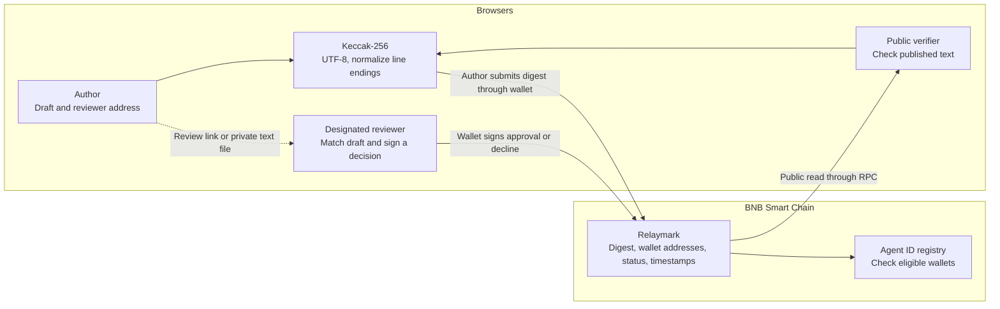
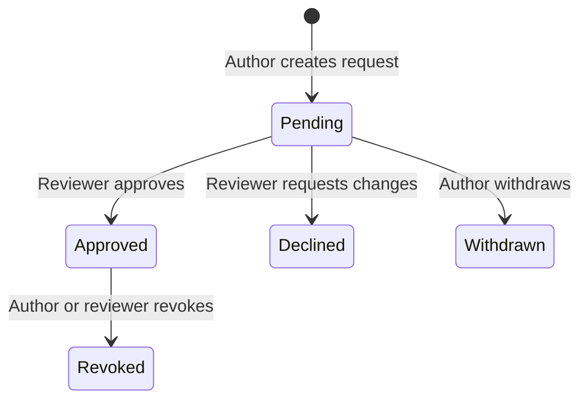

<p align="center">
  
</p>

<h1 align="center">Relaymark</h1>

<p align="center">Approve the exact words before they go live.</p>

<p align="center">
  <a href="https://relaymark-rho.vercel.app"></a>
  <a href="https://bscscan.com/address/0x423b8701da3a251a3a3fc2d241b71e8d05744c91#code"></a>
  <a href="LICENSE"></a>
</p>

<p align="center">
  <a href="https://relaymark-rho.vercel.app/docs">Docs</a> ·
  <a href="https://relaymark-rho.vercel.app/faq">FAQ</a> ·
  <a href="#security-and-privacy">Security and privacy</a> ·
  <a href="#run-locally">Local setup</a>
</p>

## The problem

A sign-off in chat or email can become detached from the draft it refers to.
When the wording changes before publication, a team may have to reconstruct which version a reviewer actually approved.

Relaymark records a decision against the fingerprint of one exact text.
Two distinct Agent ID wallets submit and review it. Anyone with the receipt and the published text can verify the active approval without connecting a wallet.

## How it works

1. **Request approval.** The author enters the reviewer’s Agent ID wallet and the draft. Relaymark checks both identities and estimates the BNB gas needed to record the request.
2. **Share the draft.** Use the review link or send the text file privately alongside the public receipt. The reviewer checks the draft against the recorded fingerprint.
3. **Record a decision.** The designated reviewer approves or requests changes. The author can withdraw a pending request. Either participant can revoke an active approval.
4. **Publish and verify.** Share the public receipt. A reader pastes or uploads the published text to check it against the fingerprint and current decision.

A request for changes records a decline. The author sends a new request for the revised text. The review link can carry the earlier receipt so Relaymark can verify both drafts and show changed lines.

## Architecture





The React client handles draft text and verification. Viem reads BNB Smart Chain and prepares wallet transactions. The contract enforces roles and records decisions. Vercel serves the frontend and handles direct links to receipts.

| Deployment | Value |
| --- | --- |
| Network | BNB Smart Chain mainnet · chain ID 56 |
| Relaymark contract | [`0x423b8701da3a251a3a3fc2d241b71e8d05744c91`](https://bscscan.com/address/0x423b8701da3a251a3a3fc2d241b71e8d05744c91#code) |
| Source verification | [Exact source match on Sourcify](https://repo.sourcify.dev/56/0x423B8701Da3a251a3A3fc2d241b71e8d05744C91) |
| Agent ID registry | [`0x60B9262456dE011F7d15a54CdD8c48bAaa8B022F`](https://bscscan.com/address/0x60B9262456dE011F7d15a54CdD8c48bAaa8B022F) |

## Security and privacy

| Area | Guarantees and limits |
| --- | --- |
| On-chain data | The digest, wallet addresses, timestamps, blocks, status, and event history are public. Draft text and titles stay off-chain. |
| Draft sharing | A review link carries the draft in its browser fragment. Anyone who has the full link can read it. Drafts saved on a device can remain in browser storage. For sensitive text, use a private channel and share the plain receipt separately. |
| What approval proves | An active approval links the designated wallet’s decision to the exact text after line-ending normalization. It does not establish real-world affiliation or factual accuracy. A title or earlier receipt used for comparison is outside the fingerprint. |
| Wallet and contract | The contract has no owner, upgrade mechanism, asset custody, or payable methods. Writes are signed in a wallet and can cost BNB gas. Relaymark does not ask for a private key or recovery phrase. |
| Verification | A public read checks the latest status. Source verification lets readers inspect the deployed code. It is distinct from an independent security audit. |

Report a suspected vulnerability privately to the maintainer. Include the affected version and enough detail to investigate. Keep keys, draft text, and live transaction authorizations out of public issues.

## Project structure

```text
relaymark/
├── contracts/
│   └── Relaymark.sol           Immutable approval ledger
├── public/
│   └── favicon.svg             Browser tab and README mark
├── scripts/
│   └── deploy-wallet.mjs        Local browser-wallet deployment
├── src/
│   ├── App.tsx                 Routes and application shell
│   ├── Compose.tsx             Draft composer and request preflight
│   ├── Help.tsx                 Docs and FAQ
│   ├── Landing.tsx              Landing page
│   ├── Receipt.tsx              Review, decision, and verification screen
│   ├── ReceiptComparison.tsx    Verified draft comparison
│   ├── Verify.tsx               Public receipt lookup
│   ├── Workspace.tsx            Requests by wallet
│   ├── assets/
│   │   └── relaymark.svg        In-app navigation mark
│   ├── chain.ts                 RPC, contract calls, and confirmation
│   ├── documents.ts             Hashing, review links, and browser storage
│   ├── main.tsx                 App entry point
│   ├── styles.css               Layout and design tokens
│   ├── transaction.tsx          Transaction confirmation and wallet handoff
│   ├── ui.tsx                   Shared controls and mark
│   └── wallet.tsx               Wallet discovery and session
├── test/
│   └── Relaymark.t.sol          Foundry contract tests
├── .env.example                 Public frontend configuration
├── .gitattributes               Git line endings
├── .gitignore                   Local and generated files
├── brand.md                     Brand guidelines
├── foundry.toml                 Solidity compiler and build settings
├── index.html                   App document
├── LICENSE                     MIT license
├── package-lock.json            Dependency lockfile
├── package.json                 Dependencies and scripts
├── README.md                    Project documentation
├── tsconfig.json                TypeScript configuration
├── vercel.json                  Routes, hosting, and response headers
└── vite.config.ts               Frontend build configuration
```

## Run locally

Use Node.js 22.12 or later, npm, and [Foundry](https://getfoundry.sh/) for Solidity tests.

```sh
npm ci
npm run dev
npm run check
forge test
npm run build
```

Copy `.env.example` to `.env.local` and set `VITE_CONTRACT_ADDRESS` to enable contract reads and writes. `VITE_BSC_RPC_URL` is an optional public HTTPS endpoint for the browser. Frontend `VITE_` values are public.

For isolated testing, start Anvil, deploy a test Agent ID registry and Relaymark, then run `npm run dev -- --mode localchain`. This mode supports overrides for `VITE_AGENT_ID_ADDRESS`, `VITE_CONTRACT_ADDRESS`, and `VITE_BSC_RPC_URL`. The production build uses the official registry on BNB Smart Chain.

## Deploy

1. Deploy `contracts/Relaymark.sol:Relaymark` with the official registry as its constructor argument. Use the compiler settings in `foundry.toml`.
2. Verify the source and constructor arguments on BscScan and check that `agentId()` returns the official registry.
3. Set `VITE_CONTRACT_ADDRESS` in Vercel and deploy the frontend. Check that a direct receipt URL loads and that two Agent ID holders can complete a request and review.

To deploy from a browser wallet, run `forge build` followed by `npm run deploy:wallet`. Open the displayed localhost URL, select the deployment wallet, and review the BNB fee in the wallet before confirming.

To use the Binance Agentic Wallet CLI, follow the [external signing reference](https://github.com/binance/binance-skills-hub/blob/main/skills/binance-web3/binance-agentic-wallet/references/external-sign.md). Relaymark prepares the zero-value call and checks the confirmed transaction against the intended action.

## License

Released under the [MIT License](LICENSE).
